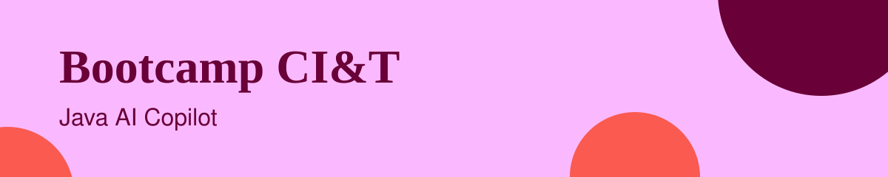
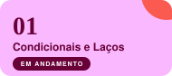
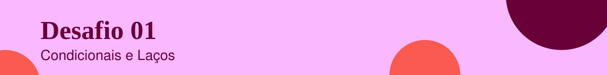
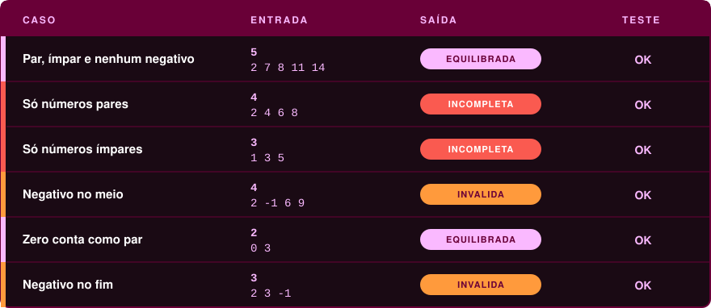
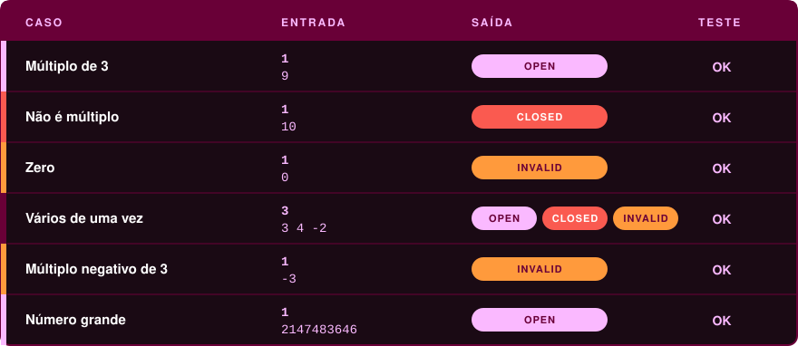

<p align="center">
  
</p>

# bootcamp-ciandt-java-ai-copilot

Desafios e exercícios do bootcamp CI&T · Java AI Copilot.

<p align="center">
  
  
  
</p>

<p align="center">
  
</p>

<p align="center">
  
  
  
</p>

## Índice

- [Progresso](#progresso)
- [Desafios](#desafios)
- [Como rodar](#como-rodar)
- [Desafio 01: Condicionais e Laços](#desafio-01-condicionais-e-laços)
- [Desafio 02: Portal Divisível por 3](#desafio-02-portal-divisível-por-3)

<p align="center">
  
</p>

## Progresso

<p align="center">
  
</p>

O desafio 01 está em andamento e o desafio 02 está concluído.

<p align="center">
  
</p>

## Desafios

<p align="center">
  <a href="01-desafio-condicionais-e-lacos/"></a>
  <a href="01-desafio-condicionais-e-lacos/02-portal-divisivel-por-3/"></a>
</p>

<p align="center">
  
</p>

## Como rodar

Os exercícios rodam no terminal e precisam apenas do JDK instalado.

 **Confira se o compilador está disponível**

```bash
javac -version
```

 **Clone o repositório e entre na pasta**

```bash
git clone https://github.com/Paula-Thamyres/bootcamp-ciandt-java-ai-copilot.git
cd bootcamp-ciandt-java-ai-copilot
```

 **Entre na pasta do exercício, compile e execute**

Exemplo com o primeiro:

```bash
cd 01-desafio-condicionais-e-lacos/01-sequencia-equilibrada
javac Main.java
java Main
```

> [!NOTE]
> Compile e execute sempre de dentro da pasta do exercício. Depois do `java Main`, o programa espera a entrada no terminal: digite os valores e aperte Enter.

<p align="center">
  
</p>

## Desafio 01: Condicionais e Laços

<p align="center">
  
</p>

<p align="center">
  
  
  
  
  
  
</p>

Desafios de código sobre condicionais e laços com Java.

### 1. Sequência equilibrada

Lê uma sequência de números e diz se ela é `equilibrada` (tem par, ímpar e nenhum negativo), `invalida` (tem algum negativo) ou `incompleta` (só pares ou só ímpares).

Leio a lista inteira mesmo depois de achar um negativo, para não deixar número sobrando na entrada. E uso `hasNextInt()` antes de cada leitura, então se faltar número o programa não quebra.

> [!TIP]
> Ao testar, digite também entradas que deveriam dar errado, como um número negativo no meio da lista.

#### Desafio

Em uma maratona de estudos de Java, a Academia Loop and If criou um painel que avalia sequências digitadas pelos novatos. Cada participante envia vários números inteiros, e o painel precisa decidir rapidamente se a sequência foi equilibrada. Uma sequência será considerada equilibrada quando contiver pelo menos um número par, pelo menos um número ímpar e nenhum valor negativo. Como o painel será usado em desafios introdutórios, a verificação deve ser simples, direta e feita com condicionais e laços.

Sua tarefa é ler uma quantidade informada de valores e analisar a lista completa. Se todos os números forem maiores ou iguais a zero e houver ao menos um par e ao menos um ímpar, imprima `equilibrada`. Se existir qualquer número negativo, imprima `invalida`. Caso não haja negativos, mas todos os números forem apenas pares ou apenas ímpares, imprima `incompleta`. O problema deve ser resolvido processando os valores em um único programa, sem depender de arquivos extras ou bibliotecas externas.

#### Entrada e saída

<table>
  <tr>
    <td align="center" valign="middle"></td>
    <td valign="middle">A primeira linha contém um inteiro N, indicando quantos números serão analisados. A segunda linha contém N inteiros separados por espaço. Considere 1 &lt;= N &lt;= 100.</td>
  </tr>
  <tr>
    <td align="center" valign="middle"></td>
    <td valign="middle">Imprima exatamente uma das três palavras: <code>equilibrada</code>, <code>invalida</code> ou <code>incompleta</code>, de acordo com a análise da sequência.</td>
  </tr>
</table>

#### Exemplos e casos de teste

<p align="center">
  
</p>

#### O que aprendi

<table>
  <tr>
    <td align="center" valign="middle"></td>
    <td valign="middle">
      <ul>
        <li>Ler a lista inteira antes de decidir evita deixar número sobrando na entrada.</li>
        <li>Conferir com <code>hasNextInt()</code> antes de cada leitura impede o programa de quebrar quando falta número.</li>
      </ul>
    </td>
  </tr>
</table>

<p align="center">
  
</p>

## Desafio 02: Portal Divisível por 3

<p align="center">
  
</p>

<p align="center">
  
  
  
  
  
</p>

Lê uma quantidade de tentativas e, para cada número, diz se o portal abre (`OPEN`), continua fechado (`CLOSED`) ou se a tentativa é inválida (`INVALID`).

Deixei a regra do portal numa função separada, para o laço só ler os números e montar a saída.

#### Desafio

Na Academia dos Desafios de Código, cada aprendiz precisa atravessar um corredor de portais numerados. Um portal só se abre quando o número informado segue uma regra simples de treinamento: ele deve ser positivo e divisível por 3. O mestre quer um verificador automático para analisar vários portais em sequência e registrar o resultado de cada tentativa.

Implemente um programa que leia uma quantidade de testes e, para cada número recebido, decida qual mensagem deve ser exibida. Se o número for menor ou igual a zero, a tentativa é inválida. Se for positivo e divisível por 3, o portal abre. Caso contrário, o portal permanece fechado. Esse desafio foi criado para praticar condicionais e laços, portanto a solução deve processar todos os casos usando repetição e decisões simples. Cada resultado deve ser produzido de forma independente, na mesma ordem em que os números forem lidos.

#### Entrada e saída

<table>
  <tr>
    <td align="center" valign="middle"></td>
    <td valign="middle">A primeira linha contém um inteiro N, indicando quantas tentativas serão analisadas. Nas N linhas seguintes, há um inteiro X por linha, representando o número digitado em um portal.</td>
  </tr>
  <tr>
    <td align="center" valign="middle"></td>
    <td valign="middle">Para cada tentativa, imprima uma linha. Use exatamente <code>INVALID</code> se X for menor ou igual a zero, <code>OPEN</code> se X for positivo e divisível por 3, ou <code>CLOSED</code> nos demais casos.</td>
  </tr>
</table>

#### Exemplos e casos de teste

<p align="center">
  
</p>

#### O que aprendi

<table>
  <tr>
    <td align="center" valign="middle"></td>
    <td valign="middle">
      <ul>
        <li>Checar primeiro se o número é menor ou igual a zero deixa a regra do 3 só para os positivos.</li>
        <li>Separar a regra do portal numa função deixa o laço simples e a regra mais fácil de testar.</li>
      </ul>
    </td>
  </tr>
</table>

<p align="center">
  
</p>

<p align="center">
  <a href="https://github.com/Paula-Thamyres">
    
  </a>
</p>
